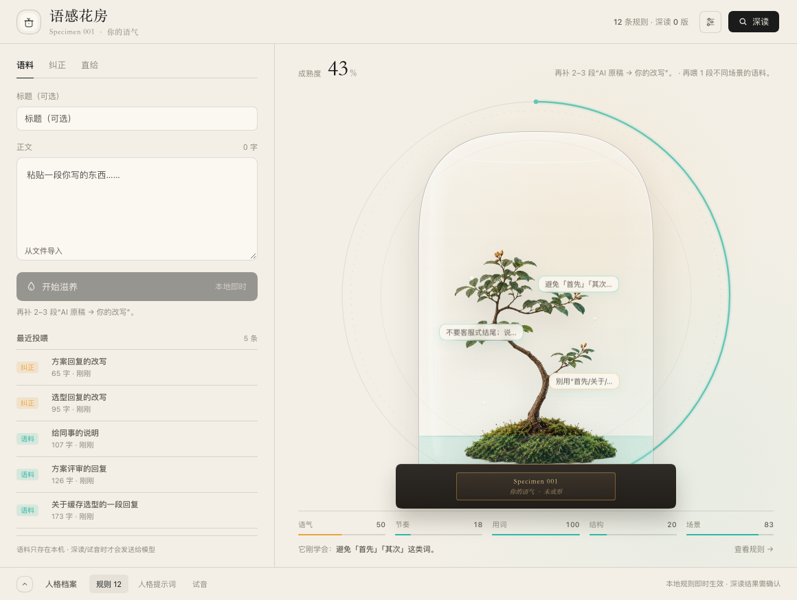
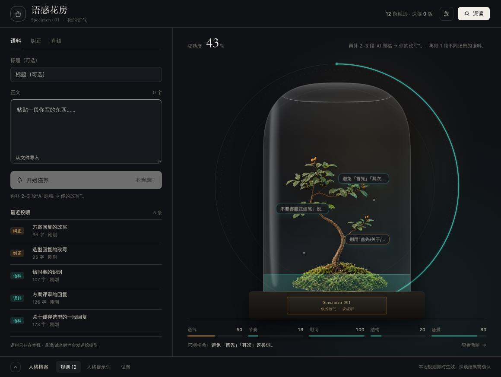

# 语感花房 · dsh-myself-preset

把你自己写的语料和纠正喂给一个玻璃花房，长出一套属于你的说话方式；编译成可切换的 DSH preset，下一句话生效。





## 它做什么

- **语料**：粘贴你写过的长文、聊天、方案。
- **纠正**：贴 AI 原稿 + 你的改写，自动提取 diff 信号（删了客套、句子拆短、结论前置……）。
- **直给**：写一条明确规则，立即生效，不用等分析。
- **深读**：让当前模型读一遍，产出带原文证据的画像和规则；结果进「待确认」，你收下后才写进人格。
- **试音**：输入一个场景，用当前人格回答；「不像」会把回答预填回纠正页。
- **人格提示词**：看当前编译结果；可以追加手改，也可以「完全接管」。

## 安装

前置：DeepSeek Harness 0.2.x（带 bundle 插件、`systemPrompt` 和 `llm` 服务）。插件没有构建步骤，安装后重启即可。已在 0.2.2-rc.1（Windows 11 / macOS 桌面版）上实测。

从 GitHub 安装：

```sh
dsh plugin --profile <profile> add github:mutexz/dsh-myself-preset
```

从市场安装：在社区插件市场 `dshmarket` 里搜索「语感花房」或 `dsh-myself-preset`，点安装。市场收录的是一条 [awesome-dsh-plugin](https://github.com/awesome-dsh-plugin/awesome-dsh-plugin) 条目，见 [market/SUBMISSION.md](market/SUBMISSION.md)。

发布 npm 后也可以：

```sh
dsh plugin --profile <profile> add dsh-myself-preset
```

安装后**完全退出 DSH 再打开**（新 Loader 行在启动时组合）。

重启后：

- 左侧栏出现「语感花房」。
- 新建会话的 preset 选择器里出现「像你」。选它，新的会话就用这套人格。
- 数据在 `~/.dsh/myself-preset/`，第一次打开是空花房。

## 怎么用

1. 打开「语感花房」。
2. 在「语料」里贴一段你写的东西，点「开始滋养」。树会长一点，底部抽屉里出现新规则。
3. 在「纠正」里贴 AI 原稿和你的改写。纠正比长文值钱，优先喂。
4. 觉得差不多时点「深读」。结果进「规则」里的待确认卡片；整版收下后人格里才有这段画像。
5. 打开「人格提示词」确认它记住了什么；不对就手改，或者回「直给」写死一条规则。
6. 新建会话，preset 选「像你」，在「试音」里验证；不像就回纠正页继续喂。

### 热更新

页面保存人格后，写的是 `~/.dsh/myself-preset/profile.md`。preset 里的 `{{myself_persona}}` 变量每次请求都会重新读这个文件，所以：

- 不用重启 DSH；
- 不用改 YAML；
- 下一句话就生效。

已有会话保留它创建时选中的 preset；要让新人格生效，新开一个「像你」的会话。

## 模型

深读和试音用**当前默认模型**；页面「设置」里可以覆盖 provider / model。

- 如果深读报空输出、`Connection error` 或 JSON 解析失败，先在设置里换一个确定能用的模型。
- 留空 = 跟随默认模型。
- 深读只送最近 20k 字的条目；更多会在 warnings 里说明。
- 试音和深读都需要模型路由；本地规则完全不联网。

## 隐私

- 语料、规则、人格都在本机 `~/.dsh/myself-preset/`；目录权限 0700、文件 0600（Windows 走系统 ACL）。
- 本地规则不联网。
- 深读/试音会把选中的文本发给当前模型提供方；页面上有明确提示。
- 「设置」里可以关闭「发送给模型」；关闭后深读/试音禁用，本地功能照常。
- 可以导出 JSON，也可以清空所有数据（需要显式确认）；每次编译前会备份 `profile.md`（最多 20 份）。
- 插件路由只接受本机同源请求；同一 DSH 页面里的其它插件仍属于同源，共享这层信任，安装第三方插件前请自行判断。
- 语料上限：单条 2 万字、最多 200 条。分析只统计最近的一部分，长文建议拆段。

## 排障

- **页面打不开 / 读取失败**：确认安装后完整重启过；检查 `dsh plugin --profile <profile> list` 里有没有 `dsh-myself-preset`。
- **页面右侧还浮着别的场景/按钮**：那是 `hero-hud` 等第三方主题插件；页面本身是不透明的，不会透出场景。
- **preset 列表没有「像你」**：安装后要重启；已有会话的 preset 不会自动换，新开会话再选。
- **深读/试音失败**：先换模型；再看页面里的错误文案，或 `~/.dsh/myself-preset/state.json` 里的 `deep.job.error`。

## 开发

另起一个调试实例：

```sh
ln -sfn "$PWD" ~/.dsh/profiles/web/node_modules/dsh-myself-preset

"/Applications/DeepSeek Harness.app/Contents/Resources/runtime/cli/bin/dsh" \
  --profile web \
  --patch "$PWD/cordis.patch.yml" \
  --port 37779 --no-open
```

改 `client/client.js` 会按 bundle 的 mtime/大小热更新；改 `lib/` 会触发宿主 HMR。没变化就刷新页面。

测试：

```sh
node --test tests/*.test.js
```

DSH 升级后如果 standard preset 增删了插件，重新生成 preset 列表：

```sh
node scripts/gen-preset.mjs                       # PATH 里有 dsh 时
DSH_BIN=/path/to/dsh node scripts/gen-preset.mjs  # 或用桌面版自带的 CLI
```

## 文件

```
package.json          main + ./client + ./preset + dsh.bundle.patch
cordis.patch.yml      bundle：页面插件行 + preset 声明行
lib/index.js          宿主路由、条目、编译、深读、试音、素材
lib/store.js          state.json / profile.md / 备份 / 原子写
lib/analyze.js        本地统计 + 纠正 diff + 规则
lib/compile.js        底座 + 规则 + 画像 + 手改 → profile.md
lib/deep.js           深读 prompt、ctx.llm 流式调用、JSON 解析
lib/persona.js        prompt 变量读文件（永远返回非空底座）
preset/index.js       preset 作用域插件：注册 {{myself_persona}}
client/client.js      浏览器页面
assets/               植物素材、截图、图标
docs/design.md        设计稿
market/               市场条目模板与提交流程
tests/                分析/编译/存储测试
```

## 卸载

```sh
dsh plugin --profile <profile> remove dsh-myself-preset
# 或从插件管理器移除
```

完全退出再打开。想连数据一起删：

```sh
rm -rf ~/.dsh/myself-preset
```

## 上架市场

见 [market/SUBMISSION.md](market/SUBMISSION.md)。核心是两步：

1. 仓库能被 `dsh plugin add` 安装（本包已声明 `dsh.bundle` + `cordis.patch.yml`）；
2. 给 [awesome-dsh-plugin](https://github.com/awesome-dsh-plugin/awesome-dsh-plugin) 提一个 `data/plugins/<owner>__<repo>.yml` 的 PR。

## Credits

- 植物素材由作者用生图模型生成，已抠图并做去底色处理。
- 设计参考：InGen Specimen Incubation Dashboard、Lucid Lab Results、Liquid Fill Progress。
- 代码 MIT，见 [LICENSE](LICENSE)。
